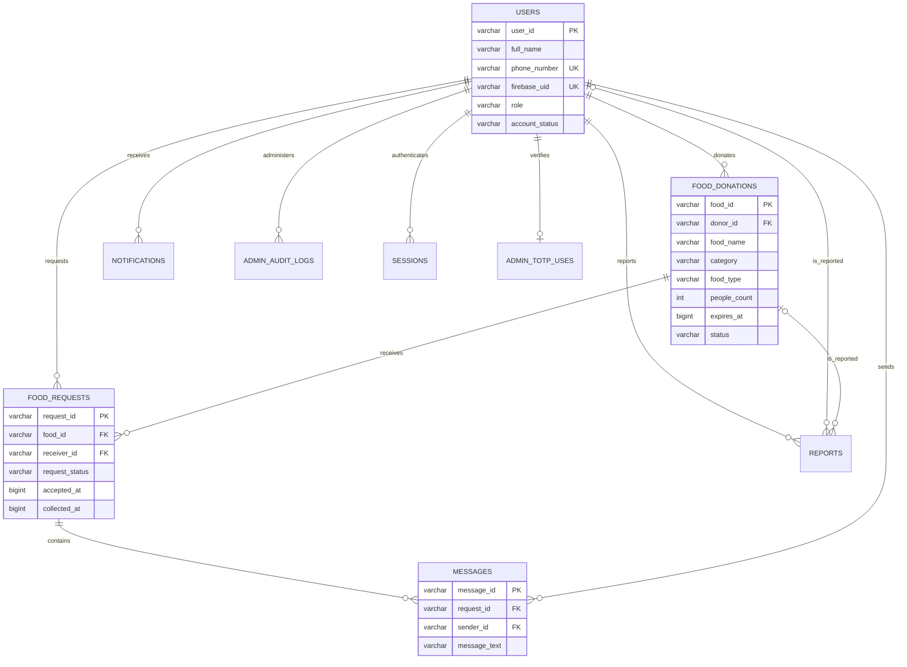
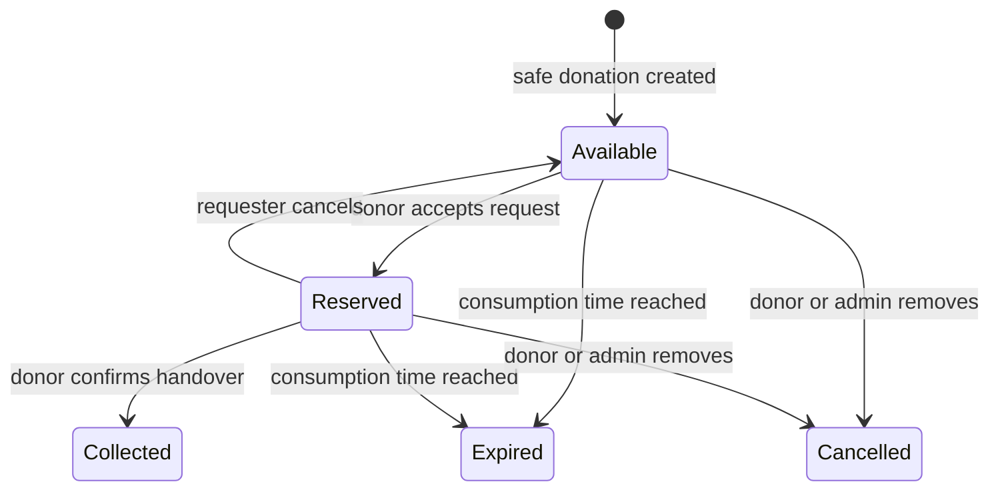

# Database and relationships

MySQL uses InnoDB, UTF-8 (`utf8mb4`), parameterized statements, foreign keys, unique verified identity constraints and indexes. IDs are UUID strings. Timestamps are UTC epoch milliseconds (`BIGINT`), converted to local readable dates at the UI boundary. This choice keeps JavaScript, MySQL and the separate SQLite demo consistent.

Each donation has one donor. A donor and receiver can each participate in many requests, but `(food_id, receiver_id)` is unique to prevent duplicate requests. A listing can have multiple pending requests. Acceptance locks the food row, checks availability/expiry, reserves it, accepts exactly one request, rejects other pending requests, and stores notifications in the same transaction. The socket broadcast happens after commit.

`notifications` and `messages` retain history. Reports identify a food listing, a user, or both. Audit logs record admin account changes, moderation, report resolution and exports. Suspending an account revokes its sessions and hides its public donations. Role promotion is a server-owner operation; normal profile and registration routes cannot assign roles.

Sessions store only the SHA-256 hash of a random 256-bit cookie token, a separate CSRF token, an expiry and an admin verification flag. OTP challenges are used only in the loopback demo and store HMAC hashes, expiry and attempt counters. Real Firebase OTPs are never stored by this backend. `admin_totp_uses` prevents authenticator-code replay.

Indexes support active/expiring food, donor histories, receiver requests, per-food request state, user notifications, request messages, sessions and demo resend limits. No cascade deletes remove donation history; inappropriate listings are cancelled and audit trails are retained.

State transitions:

The frontend never controls these state transitions directly. It calls action endpoints; server authorization and database transactions enforce them.
